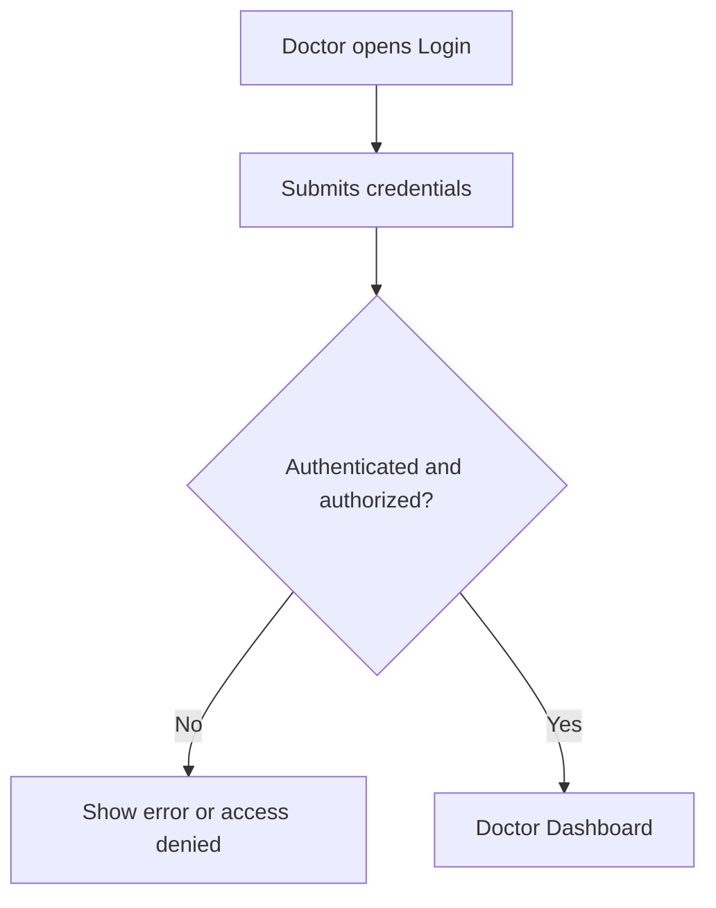
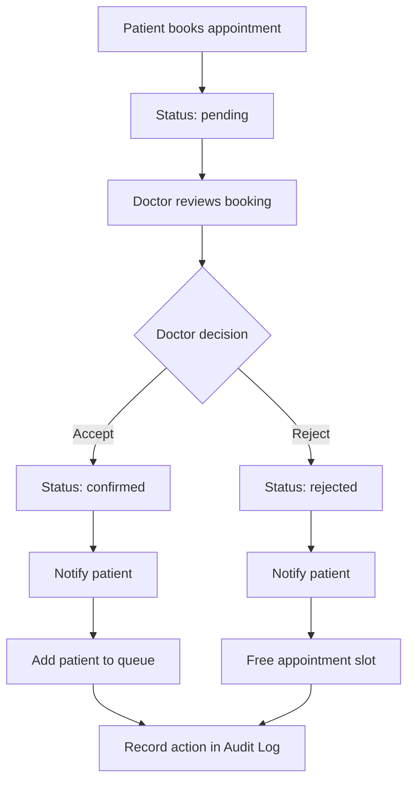
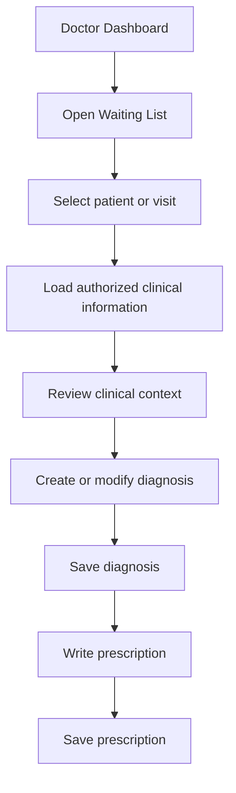
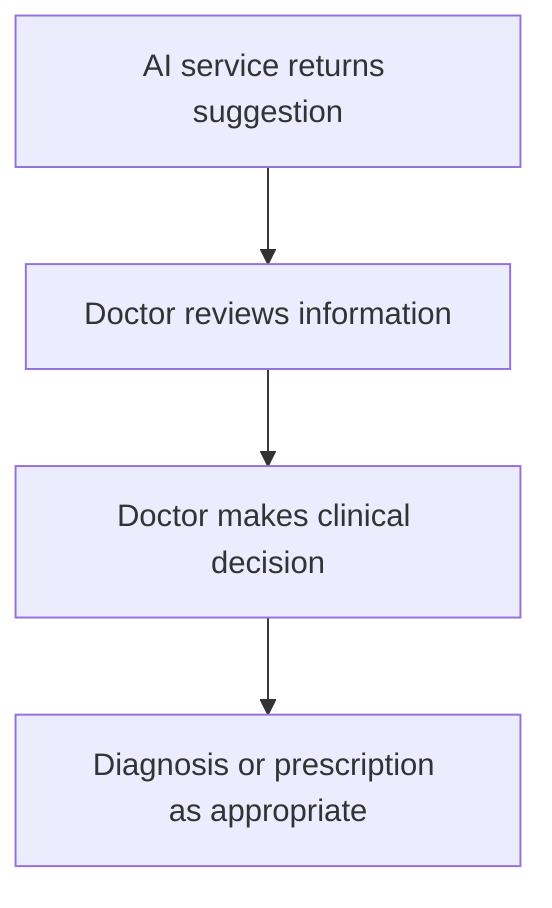

# Doctor Module — Flow

## 1. Login and Access

Authentication is documented as JWT with HttpOnly Cookies. Role-based authorization should protect Doctor routes. The exact behavior for unverified doctors must be confirmed.

## 2. Booking Approval

This follows the README's documented booking workflow.

## 3. Waiting List and Clinical Work

The detailed visit lifecycle and mandatory order of diagnosis/prescription are not defined in the README. This is a proposed flow.

## 4. AI Decision Support

AI output remains a suggestion. The physician retains authority over diagnosis, prescriptions, and medical reports.

## 5. Key Rules
- New booking starts as `pending`.
- Accept changes status to `confirmed`, notifies the patient, and adds the patient to the queue.
- Reject changes status to `rejected`, notifies the patient, and frees the slot.
- Every accept/reject action is recorded in the Audit Log.
- Doctor cannot access the patient's full account data.
- Admin handles physician ID verification and activation/rejection.

## 6. Unresolved Rule
The README mentions an additional patient confirmation / repeated non-confirmation rule, including rejection on a third occurrence, but does not fully define its states and transitions. Confirm with the team before implementing.
